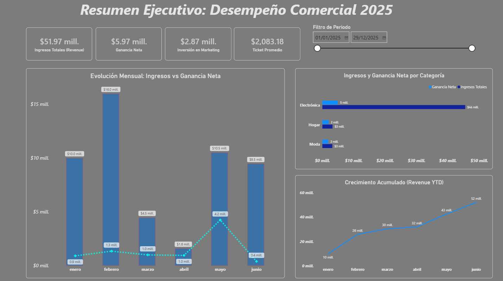
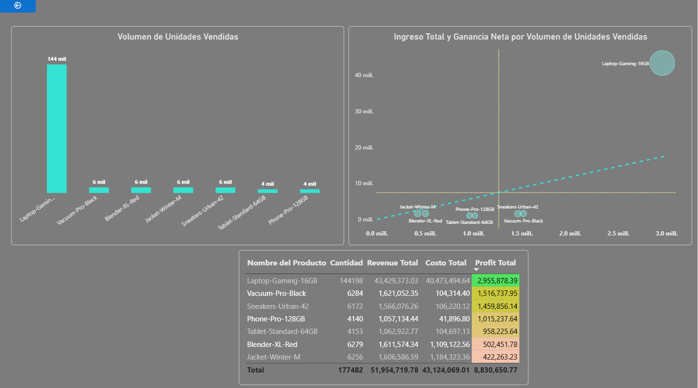

# 🚀 Proyecto RappiPlus: De Datos a Decisiones de Negocio (Python + SQL + Power BI)

## 🎯 Objetivo del Proyecto

Evaluar de forma integral el desempeño comercial, operativo y de producto de **RappiPlus (2025)** mediante un flujo de trabajo *End-to-End*, combinando limpieza y análisis financiero en **Python**, consultas avanzadas de embudo y retención en **SQL (PostgreSQL)**, validación estadística de experimentos **A/B** y visualización ejecutiva en **Power BI**.

---

## 🖼️ Vistas del Dashboard en Power BI

### 1. Resumen Ejecutivo: Desempeño Comercial 2025
Monitoreo de KPIs financieros (Ingresos Totales, Ganancia Bruta/Neta e Inversión en Marketing), evolución mensual de ingresos frente a ganancia, desglose por categoría (`Electrónica`, `Hogar`, `Moda`) y curva de crecimiento acumulado (*Revenue YTD*) con filtro dinámico de periodo.

### 2. Detalle de Productos y Rentabilidad
Análisis de volumen de unidades vendidas, gráfico de dispersión (Ingreso Total vs. Ganancia Neta por volumen) y tabla de rentabilidad por SKU con formato condicional para contrastar volumen de venta frente al margen real.

---

## 🛠️ Stack Tecnológico y Metodología

* **Python (`pandas`, `numpy`, `statsmodels`, `sqlalchemy`):** Limpieza de datos, manejo de nulos y duplicados, validación de consistencia de montos, cálculo de rentabilidad y prueba de hipótesis (Z-test para proporciones).
  
* **SQL (PostgreSQL):** Consultas con *CTEs* (`WITH`), funciones de ventana (`LAG`, `FIRST_VALUE`) y agregaciones condicionales para construir el *funnel* de conversión y la matriz de retención semanal por cohortes.
  
* **Power BI:** Modelado de datos limpios (`_clean.csv`), diseño de interfaz ejecutiva en tema oscuro, navegación entre vistas, gráficos combinados, *scatter plot* y formato condicional.

---

## 💡 Hallazgos Clave

* **Rentabilidad del negocio:** RappiPlus generó **$51.97M en ingresos totales** con un costo de producto de **$43.12M** (utilidad bruta de **$8.84M**) y una inversión en marketing de **$2.87M** (liderada por `social` con $918K y `organic` con $913K), cerrando con una **ganancia neta final de $5.97M** y un ticket promedio de **$2,083.18** (7.12 productos/orden).

* **Concentración y márgenes por SKU:** `Laptop-Gaming-16GB` domina el volumen con **144,198 unidades** y **$43.43M en ingresos** ($2.96M de profit), pero productos de menor volumen como `Vacuum-Pro-Black` ($1.52M de profit sobre $1.62M de ingresos) y `Sneakers-Urban-42` ($1.46M de profit) presentan márgenes porcentuales extraordinariamente altos.
  
* **Embudo de conversión (SQL):** La conversión global de `first_visit` (7,796 usuarios) a `purchase` (6,240 usuarios) es de **80.04%**. El mayor punto de fricción ocurre en la transición de `begin_checkout` (7,208) a `add_payment_info` (6,250), con una caída del **13.29%** (86.71% de conversión en ese paso).
  
* **Retención por cohortes (SQL):** Las cohortes de enero a mayo de 2025 mantienen una retención semanal muy estable de entre **40.07% y 43.98%** durante las primeras tres semanas posteriores al registro.
  
* **Experimento A/B en Checkout UI:** El grupo tratamiento convirtió en **16.29%** (820/5,035) frente a **15.69%** (779/4,965) del grupo control. El **Z-test para proporciones** arrojó un **p-value = 0.4161** (> 0.05), por lo que **no existe evidencia estadísticamente significativa** de que la nueva UI mejore la conversión.

---

## 📌 Recomendaciones de Negocio

1. **Optimizar el paso de pago en el checkout:** Priorizar mejoras técnicas y de UX entre `begin_checkout` y `add_payment_info` (donde se pierde el 13.29% de los usuarios), descartando el despliegue de la UI probada en el Test A/B al no mostrar impacto real.
   
2. **Escalar productos de alto margen:** Impulsar campañas de *cross-selling* y visibilidad para `Vacuum-Pro-Black`, `Sneakers-Urban-42` y `Phone-Pro-128GB`, que generan más de $1M de profit individual con costos operativos mínimos.
 
3. **Auditar el gasto de marketing sin atribución:** Revisar el etiquetado de campañas para eliminar los **$177K** registrados bajo el canal `Unknown` y reasignar presupuesto hacia los canales con mejor retorno.

---

## 📂 Estructura del Repositorio:

  * `rappiplus_analisis_integral.ipynb`: Notebook completo con ETL, rentabilidad, consultas SQL (funnel y cohortes) y prueba A/B *(credenciales de BD anonimizadas por seguridad)*.
  
  * `rappiplus_dashboard_2025.pbix`: Archivo interactivo de Power BI Desktop.
  
  * `dashboard_overview_rappi.png` / `dashboard_detalle_rappi.png`: Capturas de ambas vistas del dashboard.

## 🚀 Cómo explorar el proyecto

1. Clona este repositorio: git clone https://github.com/ricardomc41-3006/rappiplus_analytics_powerbi.git
